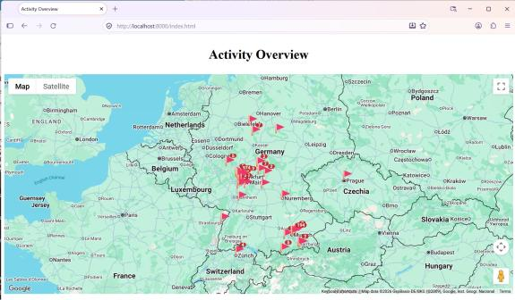
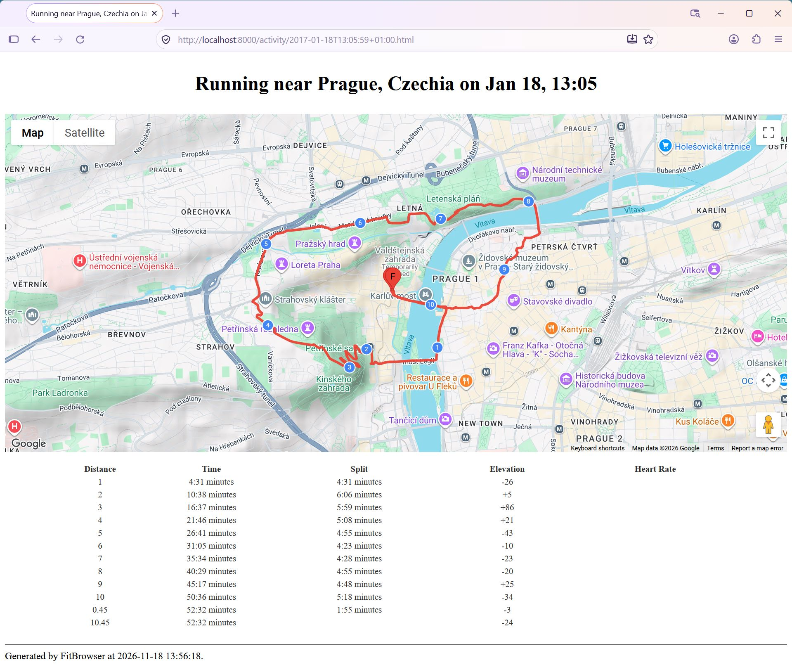

# Fit Browser

**Fit Browser** loads your fitness activities and renders their GPS
tracks in your browser, with Google Maps integration, so that you can
see your running or cycling tracks on a map.

# Background

I got robbed! Once upon a time, I paid for a license of Sport Tracks,
a software that imported all of my activities into a local database,
and allowed me to browse them, and to see them on a map. Eventually,
the publisher introduced a new version where all activities were
uploaded to their cloud. I did not like that and kept using the
legacy software version. I had paid for a perpetual license, after all.
But then the publisher published a mandatory "security update", which
did nothing for security but first showed a big, red banner at the top
saying, "this software is discontinued." Then, the software refused to
import new activity files, rendering it useless. I'm not giving them
any more of my money! Instead, I rolled my own. For me, the standout
feature was the display of my running and cycling routes on a map,
so I focused on that.

# Usage

1. Start **Fit Browser**.
2. Load activities using `Open` from the File menu, or just drag
   and drop the activity file into the application.
3. Start the built-in Web server using `Start` from the `Server` menu.
4. Click on `Open URL in Browser` from the `Server` menu. This opens
   a new browser window showing your activities.

See below for more details.

# Installation

**Fit Browser** runs on Linux, Windows, and MacOS.

- On Windows, you can download and run the `fitbrowser.exe` executable
  from the [latest release](https://github.com/Jomolungma/FitBrowser/releases/latest).

- On any platform (including on Windows, if you do not want to or are
  not allowed to run foreign-built executables), first install
  [Python](https://python.org). Make sure to include both `pip` and
  `Tcl/Tk`. Then you can either:
  - Download the [fitbrowser Wheel](https://github.com/Jomolungma/FitBrowser/releases/latest)
    and run `pip install <whl file>` in a console, or
  - Use `pip install fitbrowser` in a console to install **Fit
    Browser** from the Python Package Index.
- Afterwards, you can run `fitbrowser` or `python -m fitbrowser` in a console.

# Set Up

**Fit Browser** depends on two online services that are free to use,
Google Maps and Geonames.

## Google Maps

For Google Maps integration, you need a
[Maps Demo Key](https://developers.google.com/maps/documentation/javascript/demo-key)
from Google. This requires a private Google account. Billing information
is not necessary.

In the **Fit Browser** user interface, go to `Google Maps ...` in the
`Options` menu and enter your Maps Demo Key.

## Geonames

[Geonames](https://www.geonames.org/) is used to look up place names
corresponding to latitude and longitude values. You need to create a
free account by clicking on `Account` and `Create an account` in the
top right corner.

After creating and confirming your account, go to `Geonames ...` in
the `Options` menu and enter your _User Name_ (**not** your email
address).

# Details

**Fit Browser** can read activities in the following formats:

- Garmin FIT files (`*.fit`). When I connect my Garmin Forerunner
  235 device to a PC, these files show up in the device's `ACTIVITY`
  folder.
- Garmin Training Center files (`*.tcx`).
- Sport Tracks Logbook files (`*.logbook3`).
- Apple Health data exported as XML files (`*.gpx`).
- ZIP files containing any combination of the above.

After loading an activity file, the GUI shows the word **Loaded** in green.
Now you can configure options or choose a filter, if you like. When you are
ready, you can click `Start` in the `Server` menu to start the built-in Web
server. The status will now show **Running** in green, and the status bar
will show the URL that you can now open in your Web browser. For
convenience, you can also use `Copy URL to Clipboard` or `Open URL in
Browser` from the `Server` menu.

# The Menu

- `File`
  - `Open ...` Opens an activity. You can also choose multiple files at
    once to merge them.
  - `Close` Does the obvious. You can also use `Ctrl-w`.
  - `Exit` Does the obvious. You can also use `Ctrl-x`.
- `Filter`
  - `By date ...` Filters the activities by start and end dates.
    This can be done after loading activities, but before starting
    the Web server.
  - `Reset` Resets the date filter.
- `Server`
  - `Start` Starts the built-in Web server.
  - `Stop` Stops the built-in Web server.
  - `Copy URL to Clipboard` Copy the URL to the clipboard. You can then
    paste the URL into your favorite browser's address bar.
  - `Open URL in Browser` Starts your default browser, or opens a new
    tab in your default browser, and opens your chat history.

# Options

The `Options` menu has the following options. Note that the `Options`
menu is disabled when the built-in Web server is running.

- `Autostart` Automatically start the built-in Web server immediately
  after loading a chat archive.
- `HTML` Options related to the HTML rendering.
- `Style Sheet`
  - `Built-In` Use the built-in style sheet for formatting.
  - `Load ...` Use a separate CSS file for formatting messages.
  - `Save Template As ...` Save the built-in style sheet to a file
    for editing.
- `HTTP`
  - `Configure` Configure the host name and port number to use for the
    built-in Web server.
    - `Host Name` The host name to bind to. Using `localhost` as the
      host name is highly recommended. Using your actual host name
      might make the built-in Web server visible from your local
      network -- use at your own risk, if you know what you are doing.
      See the documenation for
      [http.server](https://docs.python.org/3/library/http.server.html).
    - `Port Number` The port number to bind to. When `0`, the built-in
      Web server automatically chooses an available port number at
      random, meaning that the URL for the built-in Web server will be
      different every time. When set to any other valid port number
      (between 1024 and 65535), the built-in Web server binds to the
      same address every time.
- `Google Maps` Configures the Google Maps API key.
- `Geonames` Configures the Geonames user name and database.
  For valid database names, see the `cities` parameter
  [here](https://www.geonames.org/export/web-services.html#findNearbyPlaceName).

# Formatting

Formatting is controlled by a CSS Stylesheet. **Fit Browser** by default
uses a built-in stylesheet. If you want to modify formatting, you can
save the built-in stylesheet using `Save Template As ...` from the
`Options` menu, edit it, and then use `Load ...` to use your modified
style sheet instead.

# Configuration

Configuration options are stored in the JSON-formatted configuration
file `~/.fitBrowser`. On Windows, this file is typically located in
`c:\Users\<your user name>`.

**Fit Browser** might misbehave if this file is broken, or
if it references files (like the style sheet) that do not exist.
So if anything goes wrong, try deleting this file. It will then
be re-created from built-in default values.

# Command Line

When installed from the Wheel or using pip, you also get the
`fitbrowser` command-line tool.

`fitbrowser` can be used to run the web server from the command line.
It also reads the `~/.fitBrowser` configuration file and therefore
applies the same options configured in the GUI.

# Issues

If the map does not show, then the Google Maps API key is incorrect.
See `Set-Up` above.

If locations are shown as numerical latitude and longitude values,
then the Geonames user name is incorrect. See `Set Up` above.

# Local Processing

**Fit Browser** processes your activity files locally, in memory, on
the fly.

The integration with Google Maps means that Google will know what
parts of the world you are looking at.

Likewise, Geonames will know the locations that **Fit Browser** is
looking up -- i.e., the start locations of your activities.
